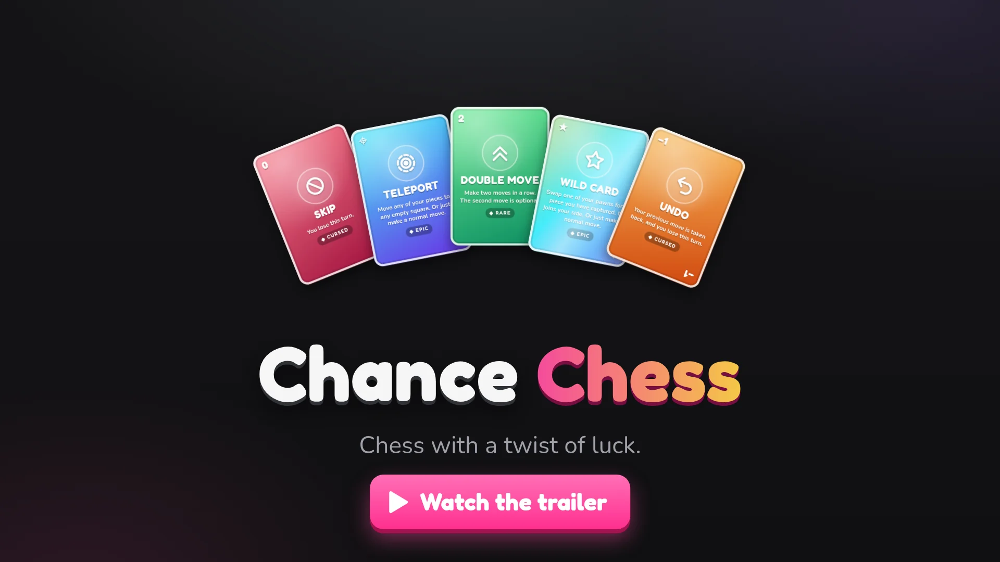

# Chance Chess

Chess with a twist of luck: before every turn you draw a card that decides what you can do.
Play the computer, pass & play on one device, or play a friend online with a share link.

**Play free at [chance-chess-sab.vercel.app](https://chance-chess-sab.vercel.app/)**

## Rules

Normal chess movement, plus:

- **Draw a card before every turn.** Each player has their own 40-card deck, reshuffled when it runs out. The card counter shows what is left in both decks.

### Game modes

- **Capture the king** (classic): there is no check or checkmate. You may leave your king attacked, and the game ends when a king is actually taken. (Castling still can't pass through attacked squares.)
- **Checkmate:** real chess rules. No move, teleport or swap may leave your own king in check, and you win by checkmate. Checkmate is decided after the draw: when no normal move can save your king, you get a dramatic last-chance draw, and only a Teleport can rescue you. With no legal move and no check, your turn is simply skipped.
- **Card hand:** like Checkmate (real chess rules, win by checkmate), but when you draw a Double Move, Wild or Teleport you can keep it (up to 3 cards) and make a normal move instead. On a later turn, play a kept card instead of the one you drew; a kept Teleport can rescue a king that would otherwise be mated. Both players can see each other's hand. Skip and Undo still hit you straight away.

| Card | Count | Effect |
| --- | --- | --- |
| 1 · Move | 20 | One normal move. |
| 2 · Double Move | 5 | Two moves in a row; the second is optional. |
| 0 · Skip | 4 | You lose the turn. |
| −1 · Undo | 3 | Your most recent move is taken back (a captured piece returns to the board), and you lose the turn. If that move can't be reversed any more (the piece was captured, or its old square is now occupied), nothing happens. |
| ★ · Wild | 5 | Swap one of your pawns for a piece you captured; it joins your side. Captured pawns can't be swapped in. Or make a normal move instead. |
| ⌖ · Teleport | 3 | Move any of your pieces to any empty square (no captures; pawns can't land on the first or last rank). Or make a normal move instead. |

**House rules** (both on by default, each can be turned off on the home page):

- **Check ends a Double Move.** Giving check ends your Double Move, so a king can't be checked and captured in one turn without a chance to respond.
- **No curses in check.** Skip and Undo are never dealt while your king is in check: they're shuffled back into your deck and you draw again. Always on in Checkmate and Card hand modes.

Draws: 200 turns in total, or only the kings left.

**Clock (optional):** 3+2, 5+3 or 10+5 (minutes each, plus seconds added after every turn). Run out of time and you lose.

**Chat:** in online games, players can message each other.

## Credits

Created by Sabrish Varadharajan ([portfolio website](https://sabrish.vercel.app/)).

- Chess pieces: the "Celtic" set by Maurizio Monge, [MIT licence](public/pieces/LICENSE.txt).
- Fonts: Fredoka and Nunito (SIL Open Font License).

## Licence

Copyright © 2026 Sabrish Varadharajan. All rights reserved. The code, artwork and text in this repository may not be copied, modified, hosted or redistributed without written permission. See [LICENSE](LICENSE).
