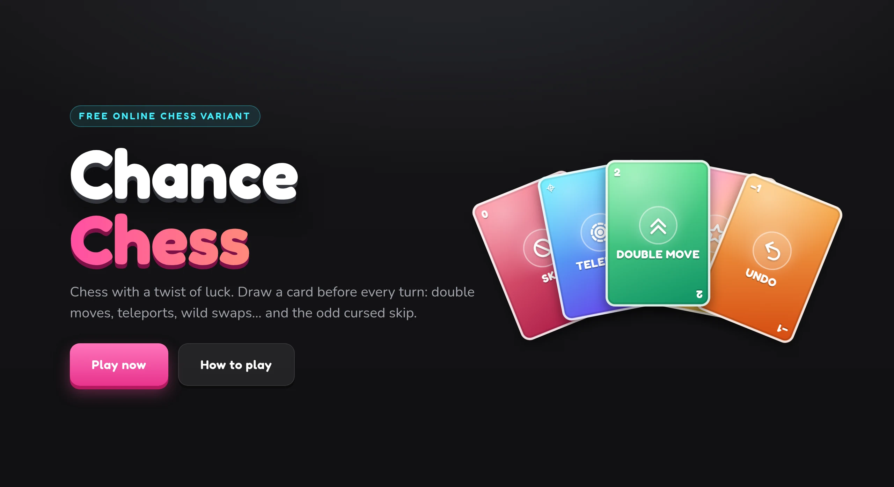
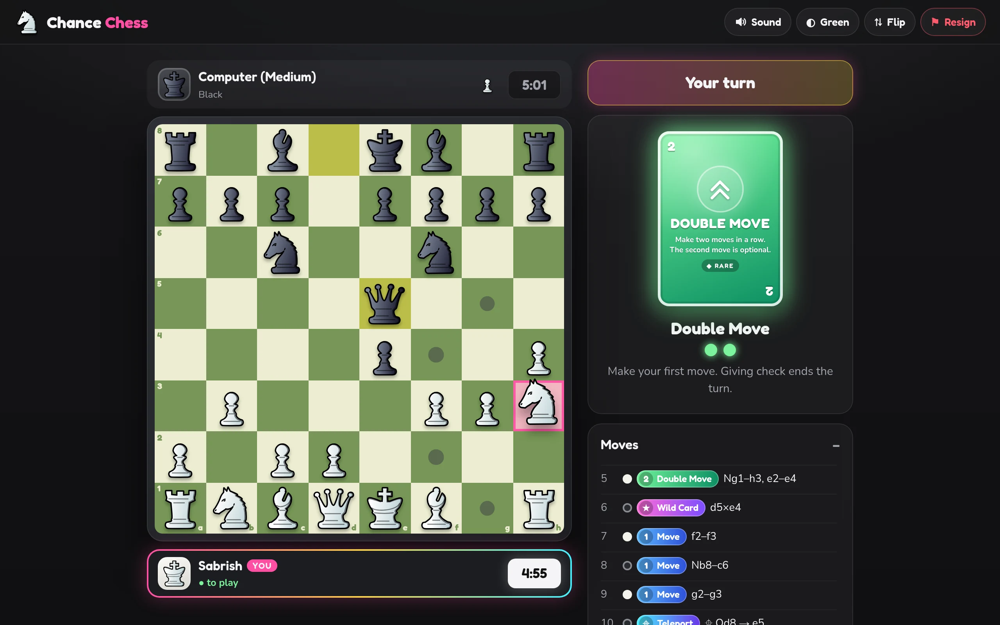
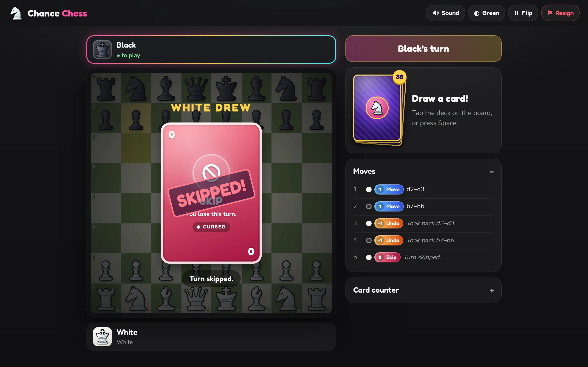
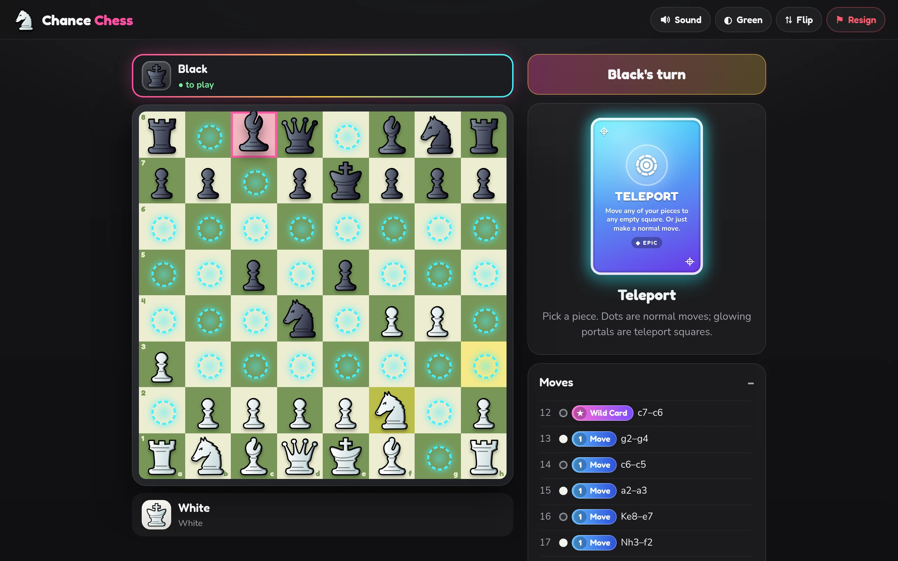

# Chance Chess

Chess with a twist of luck: before every turn you draw a card that decides what you can do.
Play the computer, pass & play on one device, or play a friend online with a share link.

**Play free at [chance-chess-sab.vercel.app](https://chance-chess-sab.vercel.app/)**

| | |
| :---: | :---: |
|  **Play the computer, a friend online, or pass & play** |  **Draw a card, then play it** (with an optional chess clock) |
|  **Cursed cards can cost you a turn** |  **Teleport any piece to any empty square** |

## Rules

Normal chess movement, plus:

- **Draw a card before every turn.** Each player has their own 40-card deck, reshuffled when it runs out. The card counter shows what is left in both decks.
- **Win by capturing the king.** There is no check or checkmate: you may leave your king attacked, and the game ends when a king is actually taken. (Castling still can't pass through attacked squares.)

| Card | Count | Effect |
| --- | --- | --- |
| 1 · Move | 20 | One normal move. |
| 2 · Double Move | 5 | Two moves in a row; the second is optional. |
| 0 · Skip | 4 | You lose the turn. |
| −1 · Undo | 3 | Your most recent move is taken back (a captured piece returns to the board), and you lose the turn. If that move can't be reversed any more (the piece was captured, or its old square is now occupied), nothing happens. |
| ★ · Wild | 5 | Swap one of your pawns for a piece you captured; it joins your side. Captured pawns can't be swapped in. Or make a normal move instead. |
| ⌖ · Teleport | 3 | Move any of your pieces to any empty square (no captures; pawns can't land on the first or last rank). Or make a normal move instead. |

**House rule (on by default, can be turned off on the home page):** giving check ends a Double Move. That way a king can't be checked and captured in one turn without a chance to respond.

Draws: 200 turns in total, or only the kings left.

**Clock (optional):** 3+2, 5+3 or 10+5 (minutes each, plus seconds added after every turn). Run out of time and you lose.

**Chat:** in online games, players can message each other.

## Credits

Created by [Sabrish](https://sabrish.vercel.app/).

- Chess pieces: the "Celtic" set by Maurizio Monge, [MIT licence](public/pieces/LICENSE.txt).
- Fonts: Fredoka and Nunito (SIL Open Font License).

## Licence

Copyright © 2026 Sabrish. All rights reserved. The code, artwork and text in this repository may not be copied, modified, hosted or redistributed without written permission. See [LICENSE](LICENSE).
